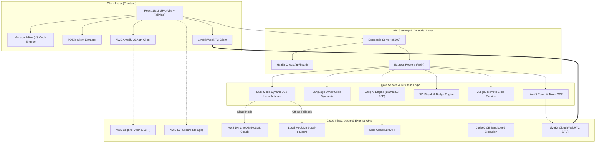
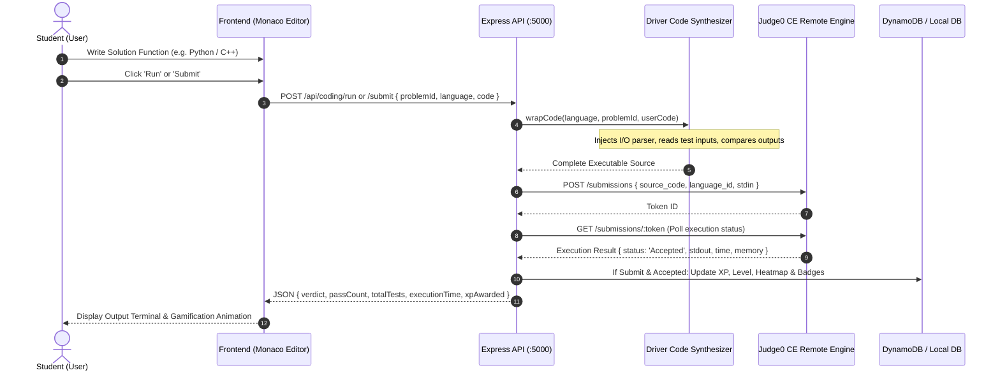
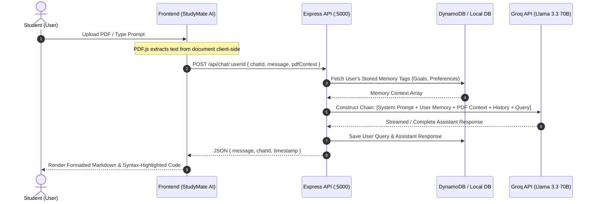

# 🧠 MindScape
### Intelligent Full-Stack AI Student Operating System & Competitive Coding Platform

<p align="center">
  
  
  
  
  
  
  
  
  
  
</p>

---

## 📌 1. Project Overview

**MindScape** (StudyMate AI) is a full-stack academic productivity platform and competitive learning operating system. It unifies high-performance AI tutoring, remote multi-language code execution, real-time WebRTC collaborative video rooms, cloud-backed document intelligence, and gamified progress tracking into a single responsive web environment.

### The Problem It Solves
Students and engineering candidates face severe context fragmentation daily:
- **Scattered Workflows**: Jumping between separate tools for note-taking, ChatGPT for homework help, LeetCode for DSA prep, Google Meet/Zoom for study groups, and Google Drive for lecture slides.
- **Generic AI Guidance**: Standard AI chat models lack long-term memory of a student's weak topics, learning style, and syllabus context.
- **Isolated Coding Environments**: Most code practice platforms don't integrate progressive hint systems, intelligent debugging assistants, or direct peer-to-peer live collaboration in the same interface.

### The MindScape Solution
MindScape functions as an all-in-one **Student OS**:
1. **Intelligent AI Study Partner**: Powered by ultra-low-latency Groq inference (`llama-3.3-70b-versatile`) with per-user persistent memory injection and client-side PDF document intelligence via PDF.js.
2. **Competitive Coding Arena**: A full-fledged LeetCode-style problem suite with Monaco Editor, remote compilation through Judge0 CE, multi-language driver code synthesis (C++, Java, Python, JavaScript), 3-tier progressive hints, and automated AI code review.
3. **Live WebRTC Study Rooms**: Zero-latency multi-peer video meetings and live coding rooms backed by LiveKit Cloud.
4. **Cloud Document & Quiz Engine**: S3-backed file management with auto-expiring presigned links and automated multiple-choice quiz generation with instant knowledge-gap diagnostics.
5. **Resilient Dual-Mode Data Layer**: Enterprise AWS integration (Cognito, S3, DynamoDB) with automated zero-configuration local mock database fallback (`local-db.json`) for seamless offline development.

---

## ✨ 2. Key Features

```
MindScape Core Feature Pillars
├── 🤖 AI Learning Hub (Groq Llama 3.3 70B, PDF Context QA, Per-User AI Memory)
├── 💻 Coding Arena (Monaco Editor, Judge0 Execution, Driver Wrapping, AI Code Review)
├── 🏆 Contests & Gamification (XP System, 15+ Badges, GitHub-Style Heatmaps)
├── 🎯 Technical & HR Mock Prep (6 Domains: DSA, OOP, DBMS, OS, Networks, HR)
├── 📹 WebRTC Video Rooms (LiveKit Cloud, Media Controls, Pre-Join Diagnostics)
├── 📁 Cloud File & Quiz Hub (AWS S3 Presigned URLs, PDF.js Text Extractor, AI Quizzes)
└── ⏱️ Focus & Analytics (Pomodoro Timer, Deep Work Tracker, Study Streaks)
```

### 🤖 AI-Powered Learning Hub
- **Llama 3.3 70B via Groq API**: Near-instantaneous response generation with markdown rendering, syntax-highlighted code blocks, and mathematical formatting.
- **Client-Side PDF Context QA**: Upload lecture slides or research papers, extract raw text client-side via PDF.js, and ask context-grounded questions.
- **Persistent AI Memory System**: Define custom personal memory tags (goals, learning pace, target languages) persisted in DynamoDB and injected into every prompt chain.
- **Time-Organized Chat History**: Auto-titled conversation threads grouped into *Today*, *Yesterday*, *Last 7 Days*, and *Older* with full rename and search capabilities.
- **Curated Prompt Templates**: Instant quick-start templates for topic summarization, step-by-step concept explanations, and comparison matrices.

### 💻 Competitive Coding Arena
- **25+ Curated Data Structure & Algorithm Problems**: Ranging from Easy to Hard across Strings, Arrays, Linked Lists, Trees, Dynamic Programming, and Graphs.
- **Monaco Code Editor**: Professional VS Code engine integration with syntax highlighting, indentation guides, and multi-language support (**C++ (GCC), Java (OpenJDK), Python 3, JavaScript (Node.js)**).
- **Judge0 Remote Execution**: Remote sandboxed execution with status reporting (`Accepted`, `Wrong Answer`, `Time Limit Exceeded`, `Runtime Error`, `Compilation Error`).
- **Dynamic Driver Code Synthesis**: Backend automatically wraps the user's algorithmic solution class into a runnable program with stream/JSON I/O parsers and custom assertions.
- **AI Code Review & Optimization**: Evaluates time complexity $\mathcal{O}(T)$, space complexity $\mathcal{O}(S)$, clean code score (1–10), edge-case resilience, and refactoring tips.
- **3-Tier Progressive Hint System**:
  - *Tier 1*: High-level intuition & algorithmic direction.
  - *Tier 2*: Recommended data structures & algorithmic pattern.
  - *Tier 3*: Pseudocode blueprint and step-by-step logic.
- **Interactive AI Debugger**: Analyzes failing test cases, runtime exceptions, and off-by-one errors with targeted remediation suggestions.

### 🏆 Contests & Gamification Engine
- **XP Progression & Levels**: Tiered XP rewards (Easy: 50 XP, Medium: 100 XP, Hard: 200 XP) with progressive level progression.
- **15+ Achievement Badges**: Unlockable milestones including *First Blood*, *Centurion*, *Speed Demon*, *Polyglot*, *Week Warrior*, and *Bug Hunter*.
- **GitHub-Style Submission Heatmap**: Daily contribution grid tracking frequency of solved problems and consistency.
- **Visual Analytics**: Interactive difficulty breakdown donut chart, language distribution bars, and submission log history.
- **Timed Contests & Real-Time Leaderboard**: Compete in scheduled contests with score computation based on solve speed and test pass rate.

### 🎯 Technical & HR Mock Interview Prep
- **Domain-Specific Question Generator**: Generate tailored interview questions across 6 core computer science tracks:
  - Data Structures & Algorithms
  - Object-Oriented Programming (OOP)
  - Database Management Systems (DBMS)
  - Operating Systems (OS)
  - Computer Networks (CN)
  - Behavioral & HR Competencies
- **Conversational AI Interviewer**: Simulates real technical interview interactions, evaluates verbal/written responses, and provides constructive feedback with model solutions.

### 📹 WebRTC Video Meetings & Collaboration
- **LiveKit Cloud Infrastructure**: High-definition, low-latency video and audio streaming with adaptive bitrate switching.
- **Pre-Join Diagnostics**: Device check interface allowing camera preview, microphone input testing, and customizable display names.
- **In-Room Collaboration Tools**: Toggle camera/microphone, screen sharing, active speaker tile grid, participants panel, and text chat.
- **Live Collaborative Rooms**: Dedicated rooms for live pair coding and peer review.

### 📁 Cloud Storage, PDF Intelligence & AI Quizzes
- **AWS S3 Cloud Vault**: Upload notes, lecture PDFs, and code snippets with client-side presigned URL generation.
- **In-Browser PDF Reader**: Built-in canvas-rendered PDF viewer with page navigation, zoom, and text extraction.
- **Automated AI Quiz Generation**: Convert any uploaded PDF text into a 5-question multiple-choice quiz with immediate grading and weak-topic identification.

### ⏱️ Focus & Productivity OS
- **Customizable Pomodoro Engine**: 25-minute focus / 5-minute break intervals with audio cues and session counters.
- **Deep Work Hour Tracker**: Cumulative tracking of uninterrupted focus time.
- **Study Streak Counter**: Daily login and activity streak tracking with longest streak records.

---

## 🏗️ 3. System Architecture

MindScape employs a decoupled, service-oriented architecture connecting a React Single Page Application (SPA) to a Node.js/Express API gateway that interfaces with AWS cloud services, Groq AI inference, Judge0 sandboxes, and LiveKit WebRTC media servers.



---

## 🔄 4. End-to-End User Flows

### Flow A: Coding Arena & Remote Execution Pipeline


### Flow B: AI Tutor with Persistent Memory & PDF Context


---

## 💻 5. Remote Code Execution & Driver Synthesis Engine

One of MindScape's core engineering highlights is its **automated driver code wrapping pipeline**. Students never need to write boilerplate I/O parsing code; they write only the solution class or method, mirroring modern competitive coding platforms like LeetCode.

### How the Engine Works:
1. **Language Identification**: The engine maps language aliases to standard Judge0 Language IDs:
   - `cpp` $\rightarrow$ ID `54` (GCC 9.2.0)
   - `java` $\rightarrow$ ID `62` (OpenJDK 13.0.1)
   - `python` $\rightarrow$ ID `71` (Python 3.8.1)
   - `javascript` $\rightarrow$ ID `63` (Node.js 12.14.0)
2. **Template Synthesis (`codeWrapper.js`)**:
   - The user's code is merged with hidden driver harnesses.
   - The harness serializes test case inputs from `problemsData.js`, invokes the solution function, stringifies the actual result, and compares it against expected output.
3. **Execution & Sandboxing (`judge0Service.js`)**:
   - Source code is transmitted with execution limits (CPU time limit: 2.0s, Memory limit: 128MB).
   - The backend polls the submission status until execution reaches a terminal state (`Accepted`, `Wrong Answer`, `Time Limit Exceeded`, `Memory Limit Exceeded`, or `Compilation Error`).
4. **AI Code Diagnostics (`aiReviewService.js`)**:
   - On request, the code is passed to Groq Llama 3.3 70B with strict JSON schema instructions to return time complexity, space complexity, code quality score (1–10), and refactored optimizations.

---

## 🔐 6. Authentication & Security Architecture

MindScape implements an authentication and session management architecture using **AWS Cognito** and **AWS Amplify v6**:

- **Self-Service Registration**: Users register with username, email, and password.
- **Email OTP Verification**: Cognito sends an email confirmation code verified via the `/verify` route before activating accounts.
- **Token Management**: AWS Amplify manages refresh tokens and JWT identity tokens automatically in browser storage.
- **Protected Route Guards**: The React frontend uses a higher-order `<ProtectedRoute />` component that checks Cognito session state before granting access to dashboard, coding arena, and meeting routes.
- **Safe Database Fallback**: AWS credentials in the backend are isolated. If AWS credentials are missing during local development, the backend automatically transitions to the built-in local JSON database without throwing fatal exceptions.

---

## 🧰 7. Complete Tech Stack

| Layer | Technology | Version | Purpose in MindScape |
|:---|:---|:---|:---|
| **Frontend Framework** | **React** | `v18.3 / v19` | Declarative UI component architecture |
| **Build Tool & Bundler** | **Vite** | `v6.4` | Lightning-fast HMR and optimized production bundling |
| **Styling** | **Tailwind CSS** | `v3.4` | Responsive layout, dark/light theme tokens, glassmorphism UI |
| **Routing** | **React Router DOM** | `v7.13` | Single-page application nested and protected routing |
| **Code Editor** | **Monaco Editor** | `v4.7` | In-browser VS Code editing experience with syntax highlighting |
| **Document Processing** | **PDF.js** | `v5.6` | Client-side PDF rendering and in-memory text extraction |
| **Real-Time Video/Audio** | **LiveKit Client** | `v2.18` | WebRTC audio/video capture, screen sharing & participant state |
| **Client Auth / Storage** | **AWS Amplify UI / SDK**| `v6.16` | Cognito user lifecycle and S3 bucket upload integration |
| **Icons** | **Lucide React** | `v1.11` | Clean UI icons |
| **Backend Runtime** | **Node.js** | `v18+` | Server-side JavaScript execution engine |
| **Web Server** | **Express.js** | `v4.19` | RESTful API routing, error handling, and JSON middleware |
| **Cloud Database** | **AWS DynamoDB** | `SDK v3` | Scalable NoSQL store for chats, AI memory, submissions, and XP |
| **Offline Database** | **JSON Flat DB** | `Custom` | Zero-config local fallback database (`local-db.json`) |
| **AI LLM Inference** | **Groq Cloud API** | `Llama 3.3 70B` | Sub-second generative AI for tutoring, review, quizzes & mock prep |
| **Code Execution Engine** | **Judge0 CE API** | `v1.13` | Isolated remote compiler and test suite evaluation |
| **Video Infrastructure** | **LiveKit Server SDK** | `v2.15` | JWT meeting token generation and WebRTC room lifecycle management |
| **Dev Orchestration** | **Concurrently** | `v8.2` | Runs frontend and backend servers simultaneously with one command |

---

## 🗄️ 8. Database Architecture

MindScape utilizes a flexible NoSQL schema designed for high-throughput reads and writes across chat histories, AI memory, coding stats, and submissions.

```mermaid
erDiagram
    USERS ||--o{ CHATS : owns
    CHATS ||--o{ CHAT_MESSAGES : contains
    USERS ||--o{ AI_MEMORY : configures
    USERS ||--|| GAMIFICATION : maintains
    USERS ||--o{ SUBMISSIONS : submits
    CONTESTS ||--o{ SUBMISSIONS : evaluates

    USERS {
        string userId PK
        string email
        string username
        string createdAt
    }

    CHATS {
        string userId PK
        string chatId SK
        string title
        string createdAt
        string updatedAt
    }

    CHAT_MESSAGES {
        string chatId PK
        string messageId SK
        string sender
        string content
        string timestamp
    }

    AI_MEMORY {
        string userId PK
        string memoryKey SK
        string memoryValue
        string category
        string updatedAt
    }

    GAMIFICATION {
        string userId PK
        int totalXP
        int level
        int streak
        string lastActiveDate
        array badges
        object solvedProblems
    }

    SUBMISSIONS {
        string userId PK
        string submissionId SK
        string problemId
        string language
        string verdict
        float executionTime
        int memoryUsed
        string timestamp
    }

    CONTESTS {
        string contestId PK
        string title
        string startTime
        string endTime
        array problemIds
        array participants
    }
```

### Table Definitions

| Table Name | Partition Key (`PK`) | Sort Key (`SK`) | Description |
|:---|:---|:---|:---|
| `studymate_chats` | `userId` (String) | `chatId` (String) | Stores chat metadata, topics, and timestamps. |
| `studymate_chat_messages` | `chatId` (String) | `messageId` (String) | Stores individual prompt/response messages. |
| `studymate_ai_memory` | `userId` (String) | `memoryKey` (String) | Per-user custom AI personalization facts and goals. |
| `studymate_gamification` | `userId` (String) | — | Tracks XP, levels, solved problem counts, and badges. |
| `studymate_submissions` | `userId` (String) | `submissionId` (String) | Historical log of problem code submissions and verdicts. |
| `studymate_contests` | `contestId` (String) | — | Scheduled contest configurations and leaderboard caches. |

---

## 📡 9. API Architecture & Endpoint Reference

The backend exposes a structured RESTful API under the `/api` namespace:

### 🤖 AI Hub & Chat Routes (`/api/chat` & `/api/ai`)
- `POST /api/ai/chat` — Direct prompt submission to Groq Llama 3.3.
- `POST /api/ai/quiz` — Generates a structured multiple-choice quiz from input text.
- `POST /api/ai/summarize` — Generates bulleted summaries from uploaded documents.
- `GET /api/chat/:userId` — Retrieves all chat threads belonging to a user.
- `POST /api/chat/:userId` — Appends a new message, triggers Groq inference, and saves response.
- `PUT /api/chat/:userId/:chatId` — Renames a chat thread title.
- `DELETE /api/chat/:userId/:chatId` — Deletes a specific conversation thread.

### 💻 Coding Arena Routes (`/api/coding`)
- `GET /api/coding/problems` — Lists all curated DSA problems with difficulty and topic filters.
- `GET /api/coding/problems/:id` — Fetches complete problem description, constraints, and starter boilerplate.
- `POST /api/coding/run` — Executes code against visible sample test cases via Judge0.
- `POST /api/coding/submit` — Executes code against all hidden test cases; updates XP and streak on pass.
- `POST /api/coding/review` — Requests comprehensive AI code review with time/space complexity analysis.
- `POST /api/coding/hint` — Returns progressive Tier 1, 2, or 3 algorithmic hints.
- `POST /api/coding/debug` — Analyzes buggy code and failing outputs with bugfix explanations.
- `POST /api/coding/interview/questions` — Generates mock interview questions across 6 domains.
- `POST /api/coding/interview/mock` — Conducts conversational mock interview evaluation.
- `GET /api/coding/dashboard/:userId` — Returns user XP, level, badge collection, and submission heatmap data.

### 📹 Real-Time Meeting Routes (`/api/meeting`)
- `GET /api/meeting/token` — Issues a signed LiveKit access token with video grant permissions.
- `POST /api/meeting/create-room` — Generates a new meeting room instance with unique share code.

### 🧠 AI Memory Routes (`/api/memory`)
- `GET /api/memory/:userId` — Retrieves all active memory tags for prompt personalization.
- `POST /api/memory/:userId` — Creates or updates a memory tag.
- `DELETE /api/memory/:userId/:key` — Removes a specific memory tag.
- `DELETE /api/memory/:userId?all=true` — Clears entire user memory profile.

### 🩺 System Routes
- `GET /api/health` — Returns server health status `{"status": "ok"}`.

---

## 📁 10. Project Structure

```
MindScape/
├── .env                              # Unified Root Environment Configuration
├── package.json                      # Workspace root (concurrently script runner)
│
├── frontend/                         # ── Frontend (React 18/19 + Vite) ──
│   ├── public/                       # Static public assets (favicons, sample pdfs)
│   ├── src/
│   │   ├── App.jsx                   # Master router & layout orchestrator
│   │   ├── main.jsx                  # Application entry point with AWS Amplify init
│   │   ├── index.css                 # Global CSS styles & Tailwind directives
│   │   │
│   │   ├── aws/                      # AWS Amplify Configuration
│   │   │   └── config.js             # Cognito UserPool & S3 Bucket bindings
│   │   │
│   │   ├── pages/                    # Core Route Pages
│   │   │   ├── Landing.jsx           # Modern public landing showcase
│   │   │   ├── Login.jsx             # User authentication form
│   │   │   ├── Signup.jsx            # User registration form
│   │   │   ├── VerifyOTP.jsx         # Email confirmation code verification
│   │   │   ├── Dashboard.jsx         # Primary Student OS Dashboard
│   │   │   ├── Meeting.jsx           # LiveKit video meeting room
│   │   │   │
│   │   │   ├── ai/                   # AI Hub Views
│   │   │   │   ├── StudyMateAI.jsx   # AI hub shell & thread navigation
│   │   │   │   └── AIChatPage.jsx    # Real-time chat & PDF context view
│   │   │   │
│   │   │   └── coding/               # Coding Arena Views
│   │   │       ├── CodingArena.jsx   # Arena shell layout
│   │   │       ├── CodingDashboard.jsx # Heatmaps, XP stats, and badges
│   │   │       ├── ProblemsPage.jsx  # Filterable problem catalog
│   │   │       ├── ProblemDetail.jsx # Split-pane problem & Monaco editor
│   │   │       ├── ContestsPage.jsx  # Active and upcoming contests
│   │   │       ├── ContestDetail.jsx # Live contest problem solving view
│   │   │       └── InterviewPage.jsx # Technical & HR mock interview prep
│   │   │
│   │   ├── components/               # Modular Reusable UI Components
│   │   │   ├── AnalyticsDashboard.jsx
│   │   │   ├── ProductivityDashboard.jsx # Pomodoro timer & task manager
│   │   │   ├── PDFViewer.jsx         # Canvas-rendered PDF reader
│   │   │   ├── FileList.jsx          # S3 file manager with presigned links
│   │   │   ├── UploadButton.jsx      # Multi-format S3 uploader
│   │   │   ├── QuizModal.jsx         # Interactive quiz taker & scoring
│   │   │   ├── ThemeToggle.jsx       # Dark/light theme switcher
│   │   │   ├── ProtectedRoute.jsx    # Cognito session route guard
│   │   │   ├── ErrorBoundary.jsx     # Graceful UI crash handler
│   │   │   │
│   │   │   ├── ai/                   # AI Hub Components
│   │   │   │   ├── AISidebar.jsx     # History threads list
│   │   │   │   ├── AIMemoryPanel.jsx # Memory tags manager
│   │   │   │   ├── PDFChatPanel.jsx  # PDF upload & context extractor
│   │   │   │   └── PromptLibrary.jsx # Instant prompt template drawer
│   │   │   │
│   │   │   ├── coding/               # Coding Arena Components
│   │   │   │   ├── CodeEditor.jsx    # Monaco editor container
│   │   │   │   ├── OutputPanel.jsx   # Execution results & test verdicts
│   │   │   │   ├── AIReviewPanel.jsx # Code review & complexity feedback
│   │   │   │   ├── AIHintPanel.jsx   # 3-tier progressive hint system
│   │   │   │   ├── AIDebugPanel.jsx  # Code debugging assistant
│   │   │   │   ├── GamificationPanel.jsx
│   │   │   │   ├── SubmissionHeatmap.jsx # GitHub-style activity grid
│   │   │   │   ├── StreakCounter.jsx
│   │   │   │   ├── DifficultyChart.jsx
│   │   │   │   ├── LanguageChart.jsx
│   │   │   │   ├── StatsOverview.jsx
│   │   │   │   ├── BadgeCard.jsx
│   │   │   │   ├── Leaderboard.jsx
│   │   │   │   ├── ContestCard.jsx
│   │   │   │   ├── LiveCodingRoom.jsx
│   │   │   │   ├── ProblemCard.jsx
│   │   │   │   ├── ProblemDescription.jsx
│   │   │   │   ├── SubmissionHistory.jsx
│   │   │   │   └── CodingSidebar.jsx
│   │   │   │
│   │   │   └── meeting/              # WebRTC Video Components
│   │   │       ├── MeetingModal.jsx  # Create/join room modal
│   │   │       ├── MeetingRoom.jsx   # Active video grid & layout
│   │   │       ├── PreJoin.jsx       # Mic/camera diagnostic check
│   │   │       ├── Controls.jsx      # AV & screen share controls
│   │   │       ├── ChatPanel.jsx     # In-meeting text chat
│   │   │       ├── ParticipantsPanel.jsx
│   │   │       └── VideoTile.jsx     # Individual peer video stream
│   │   │
│   │   ├── hooks/                    # Custom React Hooks
│   │   │   ├── useStudyTracker.js    # Local & cloud sync of study streaks
│   │   │   ├── useCloudSync.js       # DynamoDB state synchronizer
│   │   │   ├── useRecommendations.js # AI revision suggestions
│   │   │   ├── usePersonalization.js # UI theme and user preferences
│   │   │   ├── useNotes.js           # Student notebook state
│   │   │   ├── useChatManager.js     # Multi-thread chat state
│   │   │   └── useTheme.js           # Theme state management
│   │   │
│   │   ├── services/                 # API Service Clients
│   │   │   ├── ai/chatApi.js         # AI & chat API calls
│   │   │   └── coding/codingApi.js   # Problem & code execution API calls
│   │   │
│   │   └── utils/
│   │       └── pdfTextExtractor.js   # PDF.js text extraction helper
│   │
│   ├── package.json
│   ├── tailwind.config.js
│   └── vite.config.js
│
└── backend/                          # ── Backend (Node.js + Express) ──
    ├── server.js                     # Express app initialization & route registration
    ├── local-db.json                 # Automatic local mock database fallback
    │
    ├── config/
    │   └── dynamoDb.js               # Dual-mode DynamoDB client with auto local fallback
    │
    ├── routes/
    │   ├── aiRoutes.js               # AI chat & quiz routes
    │   ├── chatRoutes.js             # Chat history CRUD routes
    │   ├── codingRoutes.js           # Problem execution & contest routes
    │   ├── meetingRoutes.js          # LiveKit token & room routes
    │   ├── memoryRoutes.js           # AI memory CRUD routes
    │   └── userRoutes.js             # User profile endpoints
    │
    ├── controllers/
    │   ├── aiController.js           # Quiz generation & summarization controller
    │   ├── chatController.js         # Chat persistence & Groq interaction controller
    │   ├── codingController.js       # Code submission & test execution controller
    │   ├── contestController.js      # Contest management & leaderboard controller
    │   ├── meetingController.js      # LiveKit room token controller
    │   ├── memoryController.js       # AI memory personalization controller
    │   └── dbController.js           # Database helper controller
    │
    ├── services/
    │   ├── judge0Service.js          # Sandboxed compilation via Judge0 CE API
    │   ├── codeWrapper.js            # C++, Java, Python, JS driver code wrappers
    │   ├── aiReviewService.js        # AI code review, hints & debugger service
    │   ├── aiCodeService.js          # AI algorithmic generator
    │   ├── gamificationService.js    # XP, level curve, badges & streak calculations
    │   └── problemsData.js           # 25+ curated problem definitions with test suites
    │
    └── package.json
```

---

## 🚀 11. Getting Started

### Prerequisites
Make sure the following tools are installed on your machine:
- [Node.js](https://nodejs.org/) (v18.0.0 or higher)
- [npm](https://www.npmjs.com/) (v9.0.0 or higher)
- [Git](https://git-scm.com/)

### 1. Clone the Repository
```bash
git clone https://github.com/akhilshah179/mindscape.git
cd mindscape
```

### 2. Configure Environment Variables
Create a `.env` file in the root directory (you can copy `.env.example` if available).

```bash
cp .env.example .env
```

Fill in the required keys in `.env` (refer to [Section 12](#-12-environment-variables) for variable details).

> 💡 **Zero-Config Instant Start**: If you do not have AWS credentials configured, leave `AWS_ACCESS_KEY_ID` empty. The backend will automatically use the built-in local JSON database (`backend/local-db.json`) so you can run the entire platform immediately!

### 3. Install All Dependencies
Install dependencies for the root workspace, frontend, and backend simultaneously:

```bash
npm run install:all
```

*(Alternatively, you can install individually: `npm install && cd frontend && npm install && cd ../backend && npm install`)*

### 4. Run the Full-Stack Application
Start both the Vite frontend and Express backend concurrently with a single command:

```bash
npm run dev
```

The services will be available at:
- 💻 **Frontend Web App**: [`http://localhost:5173`](http://localhost:5173)
- ⚙️ **Backend REST API**: [`http://localhost:5000`](http://localhost:5000)
- 🩺 **API Health Check**: [`http://localhost:5000/api/health`](http://localhost:5000/api/health)

---

## 🔑 12. Environment Variables

Below is the clean `.env` template required to run all modules:

```env
# =================================================================
# MINDSCAPE UNIFIED CONFIGURATION (.env)
# =================================================================

# -----------------------------------------------------------------
# 1. FRONTEND ENVIRONMENT VARIABLES (Vite Client)
# -----------------------------------------------------------------
VITE_API_URL=http://localhost:5000/api

# AWS Cognito (Authentication)
VITE_USER_POOL_ID=your_cognito_user_pool_id
VITE_USER_POOL_CLIENT_ID=your_cognito_app_client_id
VITE_IDENTITY_POOL_ID=your_cognito_identity_pool_id

# AWS S3 (Document Storage)
VITE_S3_BUCKET=your_s3_bucket_name
VITE_S3_REGION=us-east-1

# LiveKit WebRTC (Video Meetings)
VITE_LIVEKIT_URL=wss://your-project.livekit.cloud

# Direct Client AI Key (Optional)
VITE_GROQ_API_KEY=your_groq_api_key_here

# -----------------------------------------------------------------
# 2. BACKEND ENVIRONMENT VARIABLES (Express Server)
# -----------------------------------------------------------------
PORT=5000

# Groq LLM Inference API (Required for AI Hub & Code Review)
GROQ_API_KEY=your_groq_api_key_here

# AWS Credentials (Optional: leaves empty to use backend/local-db.json)
AWS_REGION=us-east-1
AWS_ACCESS_KEY_ID=
AWS_SECRET_ACCESS_KEY=

# LiveKit Server SDK (For issuing meeting JWT tokens)
LIVEKIT_API_KEY=your_livekit_api_key
LIVEKIT_API_SECRET=your_livekit_api_secret

# Judge0 CE Remote Code Execution
# Free public endpoint:
JUDGE0_API_URL=https://ce.judge0.com
JUDGE0_API_KEY=
# Or RapidAPI production key:
# JUDGE0_API_URL=https://judge0-ce.p.rapidapi.com
# JUDGE0_API_KEY=your_rapidapi_key
```

---

## 🧭 13. Application Route Map

| Path | Access Level | Description |
|:---|:---|:---|
| `/` | **Public** | Landing page showcasing platform features and live demo entry points |
| `/signup` | **Public** | New user registration with email, password, and username |
| `/verify` | **Public** | Cognito OTP confirmation screen |
| `/login` | **Public** | User sign-in interface |
| `/dashboard` | **Protected** | Main Student OS: Pomodoro timer, S3 files, analytics & quiz taker |
| `/ai` | **Protected** | AI Learning Hub root interface |
| `/ai/chat/:chatId` | **Protected** | Specific multi-thread conversation with PDF context |
| `/coding` | **Protected** | Coding Arena Dashboard: heatmap, stats, XP, recent submissions |
| `/coding/problems` | **Protected** | Full problem catalog with difficulty and topic filters |
| `/coding/problem/:id` | **Protected** | Split-screen problem solver with Monaco Editor & AI review |
| `/coding/contests` | **Protected** | Active and upcoming competitive contest list |
| `/coding/contest/:id` | **Protected** | Timed contest workspace with live problem navigation |
| `/coding/interview` | **Protected** | Mock interview prep across 6 core CS tracks |
| `/coding/room/:roomId`| **Protected** | Live collaborative coding room |
| `/meeting/:roomId` | **Protected** | LiveKit WebRTC video meeting room with screen sharing |

---

## 📈 14. Engineering Highlights & Design Decisions

### 1. Dual-Mode Resilient Database Layer
Instead of hard-locking the application to an active AWS DynamoDB connection, the backend uses a transparent database proxy in `dynamoDb.js`. If AWS credentials fail or are omitted, the system seamlessly routes queries to an atomic `local-db.json` store without breaking any API contract.

### 2. Client-Side Document Parsing with PDF.js
To minimize server memory overhead and avoid streaming large binary files to external AI endpoints, PDF parsing is performed directly inside the user's browser using `pdfjs-dist`. Only the extracted, sanitized text is transmitted to the backend for context grounding.

### 3. Automated Boilerplate Synthesis for 4 Languages
The `codeWrapper.js` service parses input formats (arrays, linked lists, binary tree string representations) and generates language-compliant driver wrappers for C++, Java, Python, and JavaScript, enabling LeetCode-grade evaluation over Judge0 CE.

### 4. 3-Tier Progressive AI Hinting Architecture
Rather than outputting entire solutions, the AI hint service enforces a structured pedagogical model. It returns Tier 1 intuition first, progressing to Tier 2 algorithmic patterns, and Tier 3 pseudocode blueprints only upon user request.

### 5. Multi-User WebRTC Architecture with LiveKit Cloud
Video conferencing leverages LiveKit's Selective Forwarding Unit (SFU) architecture. The backend securely signs short-lived JWT tokens containing room permissions, eliminating the overhead of managing custom WebRTC signaling servers.

---

## 🔮 15. Future Roadmap

- [ ] **Collaborative Multi-Cursor Code Sync**: Integrate Yjs / CRDTs with Monaco Editor for Google Docs-style real-time multi-cursor editing in live coding rooms.
- [ ] **Automated GitHub Sync**: Push accepted solutions directly to a user's linked GitHub repository as clean commits with problem statements.
- [ ] **Audio/Voice AI Tutor Mode**: Voice-to-voice tutoring powered by OpenAI Whisper and low-latency speech synthesis.
- [ ] **Custom Contest Creator**: Allow educators to upload custom problem definitions, hidden test suites, and schedule classroom-wide private contests.
- [ ] **Spaced Repetition Flashcards**: Automatically generate Anki-compatible spaced repetition cards from marked quiz errors.

---

## 👨‍💻 16. Author & Acknowledgements

**Akhil Shah**
- **GitHub**: [@akhilshah179](https://github.com/akhilshah179)
- **LinkedIn**: [linkedin.com/in/akhilshah179](https://linkedin.com/in/akhilshah179)
- **Email**: [akhilshah179@gmail.com](mailto:akhilshah179@gmail.com)

---

<p align="center">
  <b>⭐ If you find MindScape helpful, give it a star on GitHub! ⭐</b>
</p>
